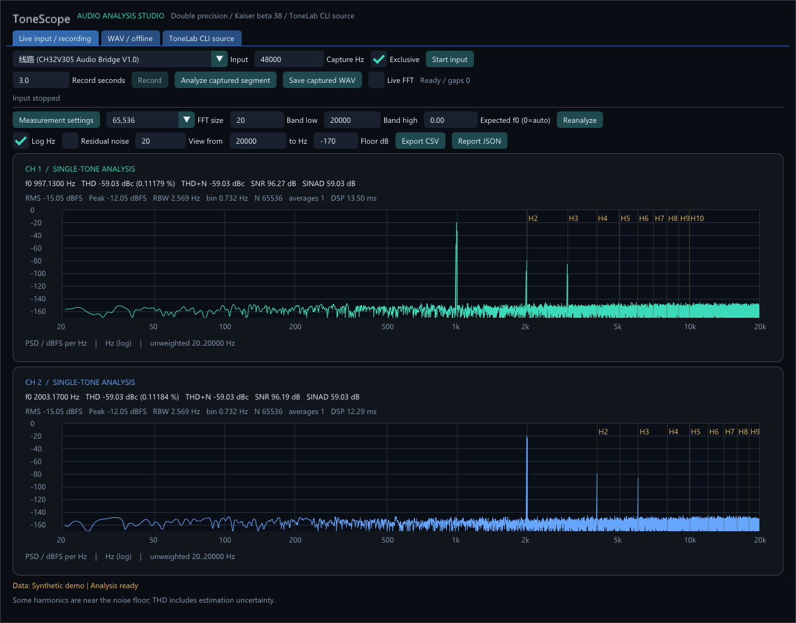

# ToneScope 音频分析器

Windows x64 / C++17 独立桌面程序，沿用 ToneLab 的深色界面和图标。启动 `ToneScope.exe`，同目录保留 `tonelab-cli.exe`。无需 MATLAB 运行库；MATLAB 仅用于开发阶段数值验算。

也提供完整的纯命令行入口 `tonescope-cli.exe`，无需启动图形界面。[Release 下载](https://github.com/lishuo4096/ToneLab/releases/tag/tonescope-v0.1.0) 中的 `ToneScope-CLI-0.1.0-windows-x64.zip` 仅打包分析 CLI、信号源 CLI 和说明/许可；完整包另外保留 GUI。项目原创部分采用 MIT License，第三方库保留各自许可。



## 已实现

- 两声道实时 PSD，对数/线性频率轴、可选显示频段、残差噪声曲线、谐波标记、鼠标读数。绘图按像素保留最小/最大值，避免缩小时漏掉窄峰。
- 物理输入 WASAPI 独占采集（选择原生采样率），或共享采集（使用 Windows mix format）。输入端暂未实现 ASIO/DirectSound；输出信号源支持现有 CLI 的三个后端。
- 录音最多 30 秒且最多 128 MiB；保存 PCM32 WAV。原生 PCM32 采样经 double 保存，未经过 float32 中转。24-in-32 数据也按其原始满量程比例保留。
- 打开/拖入 PCM、IEEE float、RF64 WAV；最多处理前两个声道。选择开始时间和长度后离线分析；FFT 16,384–1,048,576 点，最多 64 个窗口按功率平均。
- THD、THD+N、SNR、SINAD、H2–Hn、RMS、峰值、DC、削波比例、RBW、FFT bin 宽度、处理时间。报告导出 JSON，PSD/残差导出 CSV。
- 独立 `tonescope-cli.exe` 支持分析、录音、调用源做录放测量、合成参考信号与性能测试。

启动时展示 **Synthetic demo**，不会自动播放或录音。输入采集和 CLI 信号源均由按钮启动，关闭程序会停止自身启动的 CLI 子进程。

## 推荐测量流程

1. 用线缆把待测输出接到声卡线路输入，选择正确的物理输入。先做声卡自身回环，确认 ADC/DAC 噪声和失真底限。
2. `Live input / recording` 选择原生采样率，启动输入。做精密电气测量优先用独占模式；共享模式可能经过 Windows 音频处理。
3. `ToneLab CLI source` 选择输出后端、设备、正弦频率及幅度。默认只驱动左声道，右声道输出全 0；可改为右或两路。
4. 在被驱动声道看 THD；在未驱动声道观察同频泄漏，属于串扰观察。THD 的算法不要求另一个声道必须静音。
5. 等待稳定、避免输入削波，录制 2–5 秒，点击 `Analyze captured segment`。可保存录音，再到 WAV 页选择稳定时间段，增大 FFT 并重新分析。
6. 比较结果前固定带宽、谐波上限、增益、采样率、窗和源幅度。默认 20 Hz–20 kHz、不加权、计算至 H10；设置弹窗可改为 H2–H32。

“一通道播放、一通道静音”可减少互扰，并方便检查串扰。精密失真测量需要低失真正弦源；回环结果包含源、被测器件和输入 ADC 的共同贡献。关闭声道的数字输出是全 0，但模拟回采仍有底噪。

## 算法与指标口径

KISS FFT 采用 **double** 构建。频谱使用 Kaiser 窗（β=38，参考 MATLAB `thd`），归一化为单边 PSD：

`PSD[k] = 2 |FFT(x*w)[k]|² / (Fs * sum(w²))`（DC/Nyquist 不乘 2）。

`RBW = Fs * sum(w²) / sum(w)²`，`Δf = Fs/N`。PSD 用 dBFS/Hz，参考功率是样本满量程 1²，因此满量程正弦的积分 RMS 是 −3.0103 dBFS。PSD 曲线峰高随 RBW 变化，不能直接当作信号 RMS 或 THD。

先移除窗加权 DC，通过主峰附近功率质心估计非整数 bin 的基频，再做窗加权正弦/余弦最小二乘拟合与消除。要求基频至少位于第 32 个 FFT bin，以保证高抑制窗下 DC、基频与各谐波可分离；否则提示增大 FFT，不给有效失真读数。

- **THD**：带宽内 H2–Hn 的拟合功率和除以基波功率，以 dBc 或百分比显示。
- **THD+N**：移除基波后，所选带宽内的全部残差功率除以基波功率。
- **SNR**：基波功率除以移除基波及指定谐波后的带内残差功率。这是单音频谱 SNR；不是两次录音的“满量程输出/静音噪声”测试。
- **SINAD**：这里采用与 THD+N 相同的基波参考，所以等于 `−THD+N(dBc)`。

只适用于稳定单音。自动检测假设基波是搜索带内最强峰，也可填写 Expected f0。信号过小、无隔离单音或非基波内容超过基波功率 30% 时，显示频谱并标记测量无效。削波和噪声受限的谐波会提示。对于接近噪声底的谐波，THD 包含拟合不确定度；延长录音、降低 RBW 或提高合适的测试电平有助于复核。

未实现 A 计权、AES17 标准滤波、声压/电压校准、IMD、扫频和自动串扰比。这些项目不混入现有读数。GUI 实时模式使用最新完整窗口，不做多窗时间平均；离线模式平均最多 64 窗，每窗独立追踪频率，再平均线性功率。

## 性能与 MATLAB 对比

本机 384 kHz 双声道、H10、完整“PSD + 正弦拟合 + THD/噪声残差”测量：

| FFT | 样本窗口时长 | bin 宽度 | RBW | 双声道处理时间（此次实测） |
|---|---:|---:|---:|---:|
| 65,536 | 170.7 ms | 5.859 Hz | 20.550 Hz | 28.64 ms |
| 262,144 | 682.7 ms | 1.465 Hz | 5.137 Hz | 232.84 ms |

这些是 CPU 数值处理耗时，不含设备、窗口等待和显示延迟，也不是所有电脑的保证值。默认模式最多请求每秒 10 次更新，忙时保留最新窗口，避免积压；大 FFT 会降低刷新率。UI 和采集运行在独立线程。若要在 384 kHz 下得到约 1 Hz 的 RBW，需要更长窗口，不能靠把短录音补零获得真实分辨率。

本机 MATLAB R2024b Signal Processing Toolbox 交叉验证：同一个 PCM32 WAV、65536 点、同带宽、H10：

| 项目 | 两声道中最大差异 |
|---|---:|
| THD | 0.000239 dB |
| SNR | 0.005387 dB |
| SINAD | 0.000000550 dB |
| PSD（相同 DC 处理，排除 DC 数值零点） | 0.000000122 dB |

还通过已知 −99.03 dBc 失真、带限白噪声 SNR、PSD 功率归一化、非整数周期频率估计、全静音无效检测、PCM32 往返测试。CLI 集成测试额外验证 float64 WAV 中的 −140 dBc 谐波。数值方法在上述验证范围内达到 MATLAB 对应测量的精度；硬件能测到的底限仍由声卡、接线、时钟和增益决定。

## CLI

```powershell
.\tonescope-cli.exe list
.\tonescope-cli.exe analyze --input capture.wav --fft 262144 --low 20 --high 20000 --harmonics 10 --start 0.5 --duration 2 --json report.json --csv psd.csv
.\tonescope-cli.exe record --input-device 2 --rate 96000 --seconds 3 --output capture.wav

# input-device 与 output-device 各自独立编号，先查列表；输出编号由 ToneLab CLI 的 list 给出。
.\tonelab-cli.exe list --backend wasapi
.\tonescope-cli.exe measure --input-device 2 --output-device 0 --rate 384000 --seconds 2 --tone 997 --amp 0.05 --drive left --output loopback.wav --json metrics.json

.\tonescope-cli.exe benchmark --rate 384000 --fft 65536
```

中文文件路径可通过 GUI 打开；CLI 文件参数在系统正常 Unicode 参数传递下使用。WAV 解码大小限制 256 MiB，录音限制 128 MiB。停止源只结束该分析器创建的子进程，不控制用户另外启动的 ToneLab。

## 构建与验证

项目根目录运行：

```powershell
powershell -ExecutionPolicy Bypass -File scripts/build.ps1 -Test
python tests/analysis_cli_tests.py
powershell -ExecutionPolicy Bypass -File scripts/package-analyzer.ps1
```

标准 CMake 目标为 `ToneScope`、`tonescope-cli`、`analysis-tests`。依赖源码已固定在 `third_party/kissfft` 和 `third_party/dr_libs`，构建不需要联网。

物理回环验证已使用 CH32V305 Audio Bridge V1.0 的 384 kHz PCM32 双声道录音，驱动左声道 997 Hz / 0.05 FS，录制 768000 帧，采集断续 0。左路 THD 约 −86.65 dBc、20 Hz–20 kHz THD+N 约 −67.30 dBc；未驱动右路标记为无有效单音。这是此次电平与设备设置下的录放结果，不是声卡最优性能规格。

## 参考

- MATLAB THD 算法与 Kaiser β=38：https://www.mathworks.com/help/signal/ref/thd.html
- MATLAB 失真指标定义：https://www.mathworks.com/help/simulink/ug/spectrum-analyzer-distortion-measurements-panel.html
- Audio Precision THD / THD+N 区别：https://www.ap.com/blog/thd-and-thdn-similar-but-not-the-same
- ADI 通道驱动与串扰：https://www.analog.com/en/resources/analog-dialogue/raqs/raq-issue-75.html
- KISS FFT：https://github.com/mborgerding/kissfft
- dr_wav：https://github.com/mackron/dr_libs
